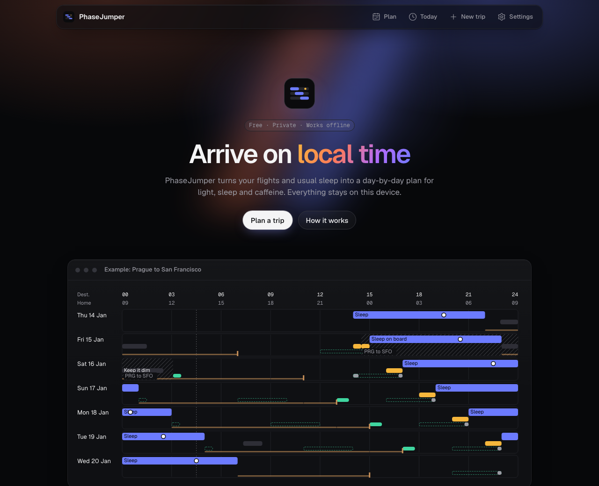

<p align="center">
  
</p>

<h1 align="center">PhaseJumper</h1>

<p align="center">
  <strong>Arrive on local time.</strong><br>
  A free, private jet-lag planner that runs entirely in your browser.
</p>

<p align="center">
  <a href="https://phasejumper.world/"><strong>phasejumper.world</strong></a> ·
  <a href="docs/README.md">Docs</a> ·
  <a href="CONTRIBUTING.md">Contributing</a>
</p>

<p align="center">
  <a href="https://github.com/Cr0wTom/phasejumper/actions/workflows/ci.yml"></a>
  <a href="LICENSE"></a>
</p>



Enter your flights and sleep habits, and PhaseJumper lays out day by day when to sleep, seek light and avoid it so your body clock lands on destination time.
No account, no server, no tracking: your trip never leaves your device.


## Quick start

Try it at **https://phasejumper.world/**, or run it locally (Node 22, pnpm):

```bash
git clone https://github.com/Cr0wTom/phasejumper.git
cd phasejumper
pnpm install
pnpm dev
```

## Documentation

See [docs/](docs/README.md).

## Contributing

See [CONTRIBUTING.md](CONTRIBUTING.md).

## License

Code: [Apache-2.0](LICENSE). Documentation: CC BY 4.0. General wellness information, not medical advice.
